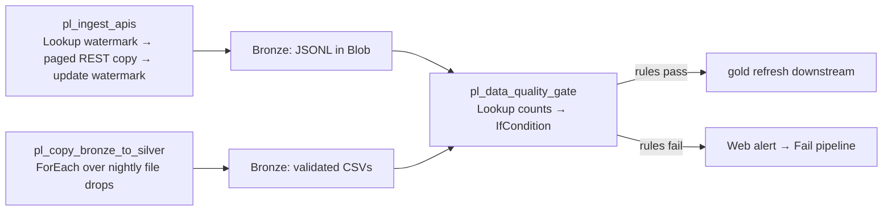

# Azure Data Factory Pipelines

**Production-style ADF orchestration for the nightly operations pipeline:
API ingestion with watermarking, file-drop copy with validation, and a data-
quality gate that fails the run — and alerts — instead of refreshing gold on
bad data.**

> ADF pipelines can't be executed by a reviewer, so this repo is documented
> like a production handoff: every JSON definition is validated by tests, and
> `docs/` explains deployment plus which screenshots prove a working run.

## Architecture



## The Why

Scheduled pipelines fail in the middle of the night, and the worst failure is
the silent one: gold refreshes on half-loaded data and dashboards lie all day.
These three pipelines encode the defenses a production nightly run needs —
watermarked incremental ingestion (no reprocessing, no gaps), contract-
validated file copies, and a quality gate that would rather fail loudly at
3 AM than publish wrong numbers at 8 AM.

## Tech decisions & trade-offs

- **Watermarking over full reloads:** `pl_ingest_apis` reads the last
  `_load_timestamp` and pages only new records. Full reloads are simpler but
  get expensive and slow as the API history grows; watermarks make the
  nightly run constant-time.
- **Parameterized linked services, Key Vault for secrets:** credentials are
  never in JSON — `ls_snowflake` and `ls_blob` resolve passwords from Key
  Vault at runtime, and account/database/user are parameters. Hardcoding
  would "work" in a demo and be a security incident in production.
- **Fail-loud quality gate:** the `IfCondition` false branch sends a webhook
  alert *then* fails the pipeline. Swallowing the failure and refreshing
  gold anyway is the anti-pattern this project exists to prevent.
- **Tests as executable documentation:** since reviewers can't run ADF, the
  pytest suite validates every definition — JSON parses, names/activities
  present, references resolve, no hardcoded secrets, retry policies on every
  external call. CI is the proof the definitions are coherent.

## Tech stack

| Layer | Tool |
|---|---|
| Orchestration | Azure Data Factory V2 |
| Storage | Azure Blob Storage (bronze) |
| Warehouse | Snowflake |
| Secrets | Azure Key Vault |
| Tests / CI | pytest, GitHub Actions |

## Setup & run

Reviewers can't execute ADF without an Azure subscription; the one-command
verification is the validation suite:

```bash
python -m pytest tests/ -q
```

To deploy to your own subscription, follow
`docs/adf_deployment_guide.md` (resources → Key Vault secrets → parameterize
→ import → validate → schedule), then capture the proof screenshots listed in
`docs/screenshots.md`.

## Synthetic data strategy

No data files ship with this repo — the pipelines operate on parameterized
paths and the JSON definitions contain only `YOUR_*` placeholder values.
Reviewers exercise the repo through the validation suite and the documented
deployment flow, never through real credentials or real data.

## Results

Screenshots to capture after deploying (see `docs/screenshots.md`):

1. Pipeline canvases for `pl_ingest_apis` and `pl_data_quality_gate`
2. A green Monitor run of the quality gate
3. A deliberately failed run showing the alert → fail path
4. Linked-service test connection (credentials masked)

## Limitations & roadmap

- Pagination rules and webhook URLs are placeholders for your environment —
  adapt `paginationRules` to your API's actual cursor format.
- No ARM/Bicep templates yet; deployment is UI + JSON import. Roadmap:
  Bicep-ify the factory for true IaC.
- Roadmap: tumbling-window trigger definitions, ADF alerts wired to
  PagerDuty/Teams instead of a generic webhook.

## Tests & CI

`tests/test_pipeline_json.py` validates: all JSON parses; every pipeline has a
name and activities; dataset references resolve to files in this repo; no
hardcoded secrets; every external-call activity (Copy, Lookup, Web) declares
a retry policy; the quality gate has a failure path. Runs in GitHub Actions
on every push.
